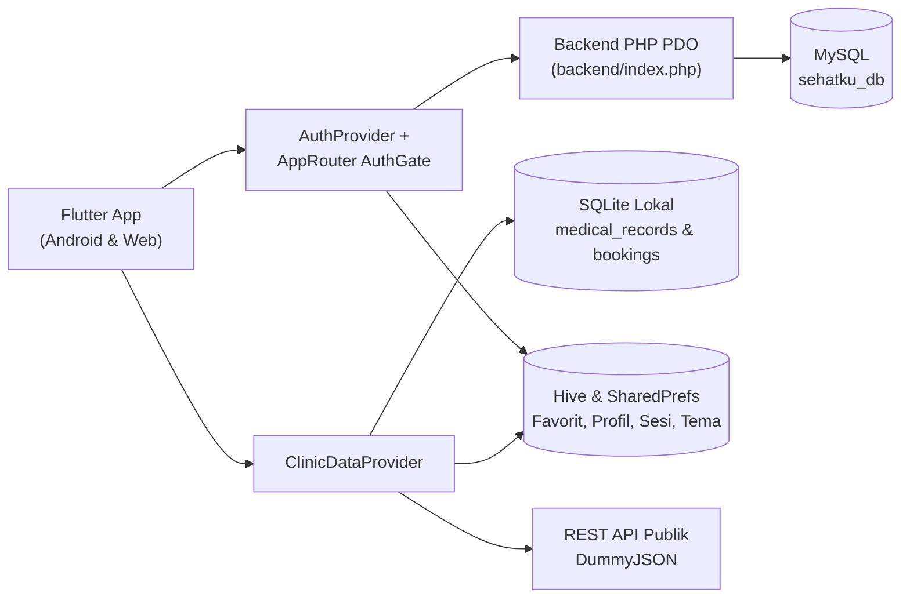
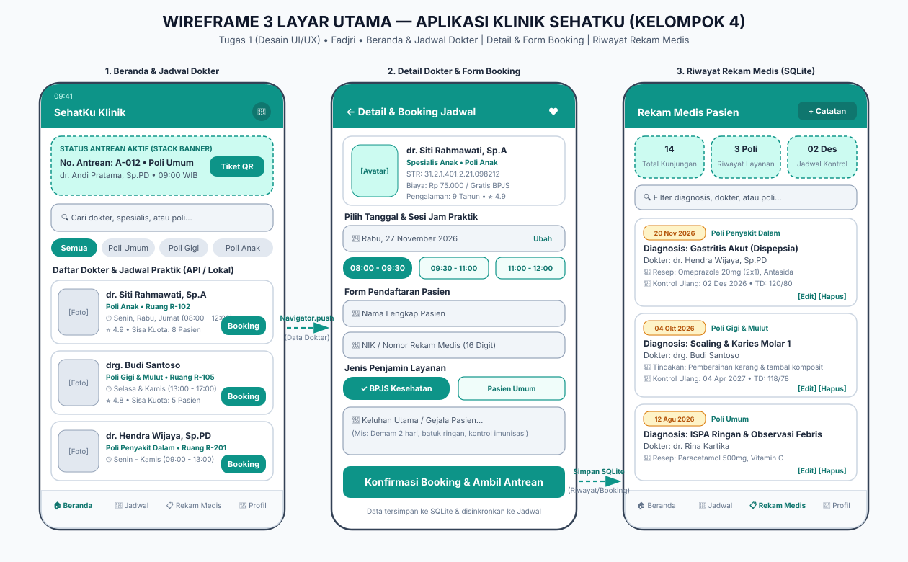
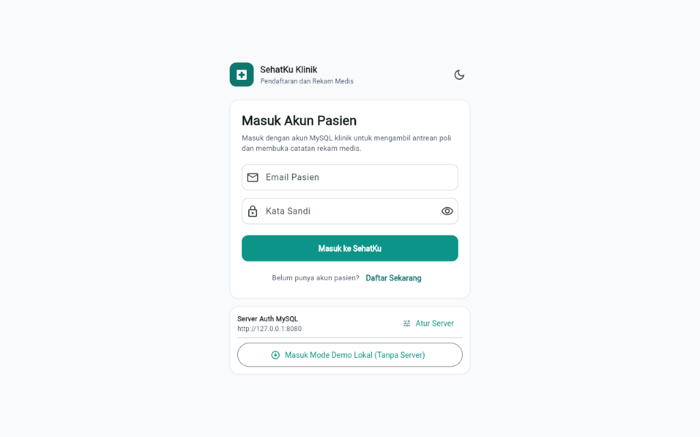
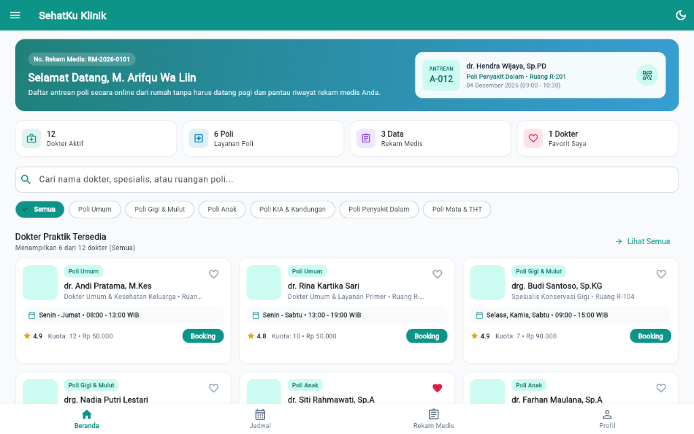
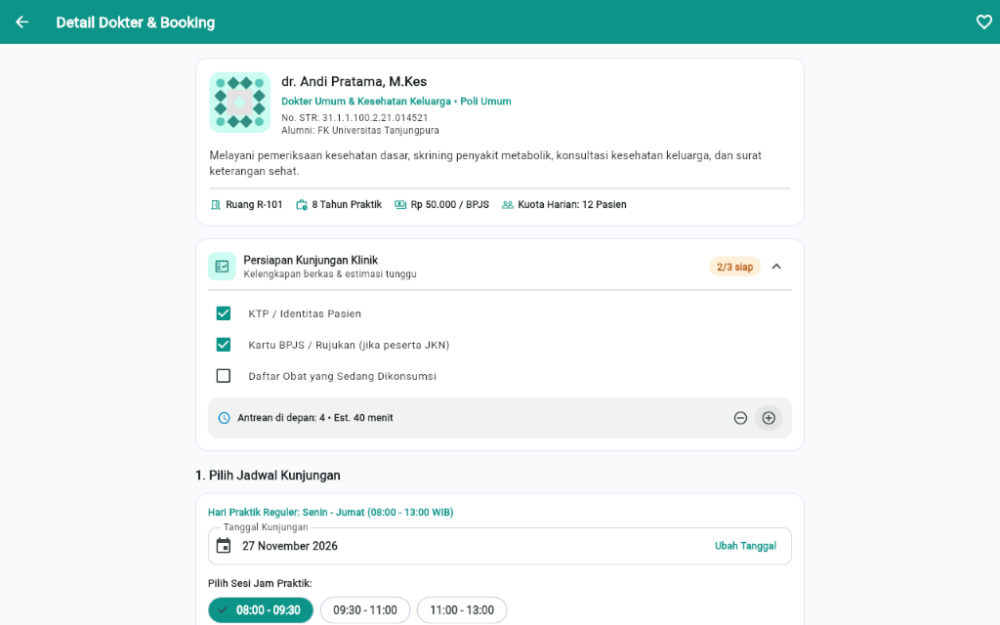
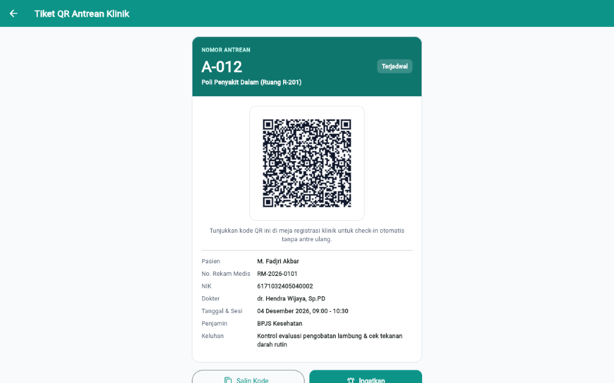
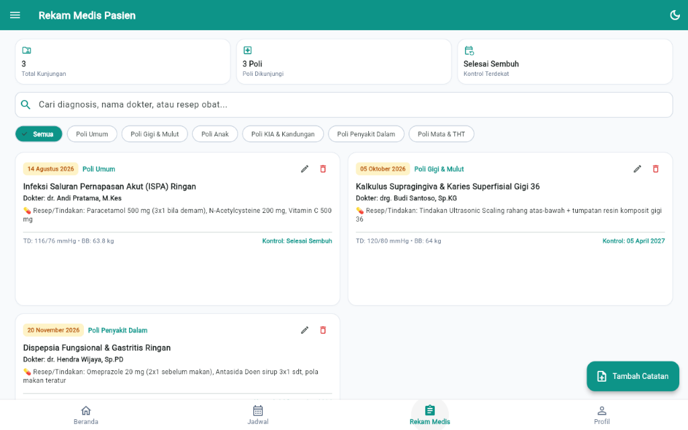
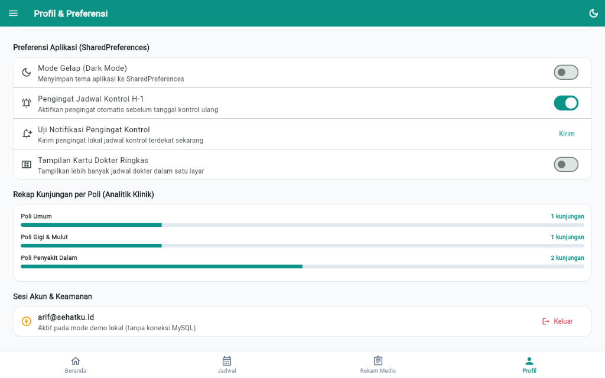

# SehatKu: Aplikasi Pendaftaran Antrean & Rekam Medis Klinik

**SehatKu** adalah aplikasi mobile dan web berbasis Flutter untuk membantu pasien klinik mendaftar antrean poliklinik secara daring, memantau jadwal praktik dokter, menyimpan catatan rekam medis ringkas secara lokal (*offline-first*), serta melakukan check-in menggunakan tiket QR antrean.

Proyek ini dikembangkan oleh **Kelompok 4** pada mata kuliah **Pengembangan Aplikasi Perangkat Bergerak (A)**, Program Studi Sistem Informasi, FMIPA Universitas Tanjungpura (Semester Ganjil 2026/2027, Dosen Pengampu: Syahru Rahmayuda, S.Kom., M.Kom.).

> **Unduh Rilis Siap Pasang (`v1.0.0`):** [Android APK Release & Flutter Web Bundle](https://github.com/arifquuu/sehatku/releases/tag/v1.0.0)

---

## Mengapa SehatKu Dibuat

Di banyak klinik pratama, pasien masih harus datang pagi lebih awal sekadar mengambil nomor antrean kertas, jadwal praktik dokter sering berubah tanpa pemberitahuan jelas, dan catatan resep atau riwayat kontrol mudah tercecer.

SehatKu dirancang untuk mengatasi tiga persoalan tersebut dalam satu alur kerja:

1. Pasien dapat melihat jadwal 12 dokter lintas 6 poliklinik (Poli Umum, Poli Gigi & Mulut, Poli Anak, Poli KIA & Kandungan, Poli Penyakit Dalam, serta Poli Mata & THT), lengkap dengan ruangan, sisa kuota harian, estimasi tarif/BPJS, dan status praktik.
2. Pendaftaran antrean selesai dalam beberapa langkah dan langsung menerbitkan nomor antrean per kode poli (`A` sampai `F`), tiket QR siap pindai untuk meja registrasi, serta pengingat notifikasi lokal di perangkat.
3. Riwayat pemeriksaan (diagnosis, keluhan, tekanan darah, berat badan, resep obat, jadwal kontrol ulang, hingga lampiran foto resep/hasil lab) disimpan secara lokal di perangkat sehingga tetap bisa dibuka meskipun koneksi internet sedang mati.

---

## Alur Penggunaan Aplikasi

1. **Masuk atau Daftar Akun Pasien (`/login`, `/register`):** Seluruh halaman utama dilindungi oleh `AuthGate`. Pasien masuk menggunakan akun MySQL (`sehatku_db`) atau mendaftar akun baru (kata sandi di-hash menggunakan `bcrypt`). Jika aplikasi diuji tanpa menyalakan server PHP lokal, tersedia tombol **Masuk Mode Demo Lokal (Tanpa Server)** pada bagian bawah layar masuk.
2. **Beranda Klinik (`/`):** Menampilkan kartu identitas pasien, tiket antrean aktif beserta tombol pintas ke **QR Antrean**, ringkasan jumlah dokter/poli/rekam medis/dokter favorit, kolom pencarian cepat, filter poli, dan artikel edukasi kesehatan dari REST API publik.
3. **Jadwal Dokter & Antrean Saya (`/jadwal`):** Terbagi menjadi dua tab. Tab pertama memuat direktori 12 dokter (bisa diganti antara tampilan daftar dan grid, serta mendukung sumber data **REST API Publik `DummyJSON`**). Tab kedua memuat riwayat antrean pasien lengkap dengan tombol **QR Antrean**, ubah status kunjungan, dan hapus riwayat.
4. **Detail Dokter & Booking Online (`/booking`):** Menerima objek `Doctor` melalui argumen rute. Pasien memilih tanggal kunjungan, sesi jam praktik, jenis penjamin (*BPJS Kesehatan* atau *Pasien Umum*), dan menuliskan keluhan. Setelah dikonfirmasi, data tersimpan ke SQLite, notifikasi lokal dikirim, dan tiket QR langsung bisa dibuka.
5. **Rekam Medis & Lampiran Foto (`/rekam-medis`):** Menyediakan operasi CRUD penuh (tambah, lihat, cari, filter per poli, edit, hapus) terhadap catatan rekam medis di SQLite, dilengkapi pemilih foto dokumen medis (resep atau hasil lab) dari galeri maupun kamera beserta penanganan izin perangkat.
6. **Profil, Dokter Favorit & Analitik Poli (`/profil`):** Menyimpan profil medis dan dokter favorit di Hive, preferensi Mode Gelap, pengingat kontrol H-1, uji kirim notifikasi lokal, tampilan kartu ringkas di SharedPreferences, grafik rekap jumlah kunjungan per poliklinik, serta tombol keluar akun.
7. **Lab Asinkron & Event Loop (`/async-lab`):** Dapat dibuka melalui menu Drawer untuk mengamati perbandingan eksekusi sinkron (blocking) vs asinkron (`Microtask`, `Event Queue`, `Timer`, `Future.wait` paralel) dan simulasi state loading, timeout, serta offline.

---

## Ringkasan Fitur dan Teknologi

| Area | Fitur di Aplikasi | Teknologi / Paket Utama | Berkas Utama |
| :--- | :--- | :--- | :--- |
| Autentikasi & Proteksi Rute | Register, Login, Logout, persistensi sesi, `AuthGate` | PHP 8.3 PDO, MySQL (`bcrypt`), `http`, `SharedPreferences` | `backend/`, `lib/providers/auth_provider.dart`, `lib/routing/app_router.dart` |
| State Global | Sinkronisasi akun, jadwal dokter, booking, rekam medis, tema | `provider` (`MultiProvider`, `ChangeNotifier`, `Selector`) | `lib/main.dart`, `lib/providers/clinic_data_provider.dart` |
| REST API Publik | Parsing JSON dokter mitra & artikel kesehatan | `http`, `DummyJSON` (`/users`, `/posts`) | `lib/services/api_service.dart`, `lib/models/doctor_model.dart` |
| Penyimpanan Lokal | CRUD rekam medis & booking, favorit, profil, preferensi | `sqflite`, `sqflite_common_ffi`, `hive_flutter`, `shared_preferences` | `lib/services/database_helper.dart`, `lib/services/local_storage_service.dart` |
| Fitur Perangkat | Notifikasi jadwal kontrol, lampiran foto resep/lab + izin | `flutter_local_notifications`, `timezone`, `image_picker`, `permission_handler` | `lib/services/notification_service.dart`, `lib/services/media_service.dart` |
| Fitur Inovatif | Tiket QR antrean siap pindai (zona tenang putih di mode gelap) & Dark Mode | `qr_flutter`, Material 3 Light/Dark Theme | `lib/screens/qr_queue_ticket_screen.dart`, `lib/theme/sehatku_theme.dart` |
| Pemrograman Asinkron | Lab Event Loop (sync vs async) & simulasi timeout/offline | Dart `Future`, `async/await`, `Future.wait`, `Completer`, `Timer` | `lib/services/async_demo_service.dart`, `tool/sync_vs_async_demo.dart` |
| Pengujian Otomatis | 13 skenario unit test, widget test & TDD (mobile & tablet) | `flutter_test`, `http/testing` (`MockClient`) | `test/widget_test.dart`, `test/arif_features_test.dart`, `test/evan_validation_tdd_test.dart` |
| Fitur Dasar & Widget Lokal | 3 program Dart dasar & checklist persiapan kunjungan (`setState`) | Dart 3, `StatefulWidget` (`setState`) | `dart_basics/`, `lib/widgets/clinic_prep_checklist_widget.dart`, `lib/utils/patient_validator.dart` |

---

## Arsitektur Sistem & Basis Data

SehatKu memakai arsitektur penyimpanan dua lapis:

1. **Server Terpusat MySQL (`sehatku_db`):** Dikelola melalui backend PHP PDO di folder `backend/` untuk registrasi dan autentikasi akun pasien/admin dengan hash `bcrypt`, serta skema relasional 6 tabel (`polyclinics`, `users`, `doctors`, `doctor_schedules`, `appointments`, `medical_records`).
2. **Penyimpanan Lokal Perangkat (*Offline-First*):** SQLite (`sehatku_clinic.db`, versi 2 dengan kolom `document_photo_path`, plus fallback Hive saat berjalan di Flutter Web) untuk CRUD rekam medis dan booking; Hive untuk dokter favorit dan profil medis; SharedPreferences untuk sesi login, Mode Gelap, pengingat kontrol, dan filter poli terakhir.



### Pratinjau Wireframe 3 Layar Utama


### Pratinjau Diagram ERD Sistem Klinik SehatKu


### Cuplikan Layar Aplikasi & Pengujian (`docs/screenshots/`)

| Halaman Masuk (`LoginScreen`) | Beranda (`HomeScreen`) |
| :---: | :---: |
|  |  |

| Detail Booking & Widget `setState` | Tiket QR Antrean (`QrQueueTicketScreen`) |
| :---: | :---: |
|  |  |

| Rekam Medis (`MedicalRecordScreen`) | Profil & Analitik Poli (`visitCountByPoli`) |
| :---: | :---: |
|  |  |

---

## Endpoint Backend Autentikasi (`backend/`)

| Metode | Endpoint | Fungsi | Header / Catatan |
| :--- | :--- | :--- | :--- |
| `GET` | `/api/health` | Mengecek status PHP dan koneksi database `sehatku_db` | Publik |
| `POST` | `/api/register` | Mendaftarkan pasien baru (NIK 16 digit, email unik, hash bcrypt) | `Content-Type: application/json` |
| `POST` | `/api/login` | Verifikasi email & kata sandi, mengembalikan Bearer token + data pasien | `Content-Type: application/json` |
| `GET` | `/api/me` | Mengambil profil pengguna aktif dari MySQL | `Authorization: Bearer <token>` |
| `POST` | `/api/logout` | Mengakhiri sesi autentikasi | `Authorization: Bearer <token>` |

Akun awal yang tersedia setelah mengimpor `database/mysql_sehatku_schema.sql`:
- Pasien: `fadjri@sehatku.id` / kata sandi `password`
- Admin: `admin@sehatku.id` / kata sandi `password`

---

## Cara Instalasi & Menjalankan Lokal

### Prasyarat
- Flutter SDK (dikembangkan dan diuji pada Flutter `3.50.1` / Dart `3.14.0`)
- PHP 8.x dengan ekstensi `pdo_mysql` dan server MySQL (Laragon atau XAMPP)
- Browser Chrome (untuk target Web) atau Emulator / perangkat Android

### Langkah Menjalankan

1. **Clone repository dan masuk ke folder proyek:**
   ```bash
   git clone https://github.com/arifquuu/sehatku.git
   cd sehatku
   ```
2. **Import skema MySQL `sehatku_db`:**
   Import `database/mysql_sehatku_schema.sql` lewat phpMyAdmin, atau jalankan lewat CLI MySQL:
   ```bash
   mysql -u root < database/mysql_sehatku_schema.sql
   ```
3. **Jalankan backend autentikasi PHP:**
   ```bash
   php -S 0.0.0.0:8080 -t backend backend/index.php
   ```
   Secara bawaan, aplikasi mengarah ke `http://10.0.2.2:8080` pada emulator Android dan `http://127.0.0.1:8080` pada Web/Desktop. Alamat server bisa diubah langsung melalui tombol **Atur Server** pada halaman Masuk.
4. **Unduh paket Flutter dan jalankan aplikasi:**
   ```bash
   flutter pub get
   flutter run -d chrome
   # atau jalankan di emulator / perangkat Android:
   flutter run
   ```
5. **Jalankan skrip konsol perbandingan sinkron vs asinkron (Tugas 8):**
   ```bash
   dart run tool/sync_vs_async_demo.dart
   ```
6. **Jalankan analisis kode dan seluruh pengujian otomatis:**
   ```bash
   flutter analyze
   flutter test
   ```
7. **Build rilis Android APK dan Flutter Web:**
   ```bash
   flutter build apk --release
   flutter build web --release
   ```

---

## Struktur Direktori Proyek

```text
sehatku/
├── assets/images/               # Aset gambar lokal banner klinik & avatar dokter
├── backend/                     # REST API autentikasi PHP PDO + MySQL (register, login, me, logout)
├── database/                    # Skema SQL MySQL (sehatku_db) & SQLite lokal
├── docs/                        # Wireframe SVG, ERD SVG, arsitektur & dokumentasi tiap jalur
├── lib/
│   ├── data/                    # Dataset lokal 12 dokter klinik lintas 6 poli & seed data
│   ├── models/                  # AppUser, Doctor, BookingAppointment, MedicalRecord, HealthArticle
│   ├── providers/               # AuthProvider & ClinicDataProvider (MultiProvider)
│   ├── routing/                 # AppRouter, named routes & AuthGate proteksi halaman
│   ├── screens/                 # Login, Register, Home, DoctorSchedule, BookingDetail, MedicalRecord, Profile, AsyncLab, QrTicket
│   ├── services/                # ApiService, AuthService, AsyncDemoService, DatabaseHelper, LocalStorageService, NotificationService, MediaService
│   ├── theme/                   # SehatKuTheme (Light/Dark Material 3) & breakpoint responsif
│   ├── utils/                   # PatientValidator (validasi NIK, nama, estimasi biaya & antrean TDD)
│   ├── widgets/                 # DoctorCard, ClinicPrepChecklistWidget (setState), & MedicalDocumentPreview (IO/Web safe)
│   └── main.dart                # Entry point MaterialApp, MultiProvider & AppRouter
├── dart_basics/                 # 3 program Dart dasar bertema SehatKu (Tugas 2 - Evan)
├── tool/                        # Skrip CLI perbandingan sinkron vs asinkron Dart Event Loop
└── test/                        # Pengujian unit & widget (widget_test.dart, arif_features_test.dart, evan_validation_tdd_test.dart)
```

---

## Dokumentasi Pendukung

| Dokumen | Keterangan |
| :--- | :--- |
| [`docs/arsitektur_dan_setup_arif.md`](docs/arsitektur_dan_setup_arif.md) | Setup platform kerja dan struktur arsitektur teknis (Arif) |
| [`docs/dokumentasi_bagian_arif.md`](docs/dokumentasi_bagian_arif.md) | Ringkasan pengerjaan dan cara verifikasi jalur Lead Developer (Arif) |
| [`backend/README.md`](backend/README.md) | Panduan menjalankan backend autentikasi PHP PDO + MySQL |
| [`docs/wireframe_dan_desain_ui.md`](docs/wireframe_dan_desain_ui.md) | Wireframe 3 layar utama dan panduan desain antarmuka |
| [`docs/erd_database_sehatku.md`](docs/erd_database_sehatku.md) | Diagram ERD dan kamus data MySQL serta penyimpanan lokal |
| [`docs/dokumentasi_bagian_fajri.md`](docs/dokumentasi_bagian_fajri.md) | Ringkasan pengerjaan jalur UI/UX & Data (Fajri) |
| [`docs/analisis_flutter_sehatku.md`](docs/analisis_flutter_sehatku.md) | Analisis pemilihan Flutter & perbandingan `setState` vs `Provider` (Evan) |
| [`docs/analisis_bisnis_sehatku.md`](docs/analisis_bisnis_sehatku.md) | Analisis bisnis rekap poli (`visitCountByPoli`) & nilai fitur inovatif (Evan) |
| [`docs/tdd_dan_testing_evan.md`](docs/tdd_dan_testing_evan.md) | Dokumentasi QA, siklus TDD, bug log integrasi & rekomendasi (Evan) |
| [`docs/laporan_akhir_sehatku.md`](docs/laporan_akhir_sehatku.md) | Laporan akhir proyek UAS PBL Kelompok 4 — SehatKu (Evan) |
| [`docs/slide_presentasi_sehatku.md`](docs/slide_presentasi_sehatku.md) | Kerangka materi slide presentasi kelompok (Evan) |
| [`docs/panduan_video_demo_sehatku.md`](docs/panduan_video_demo_sehatku.md) | Naskah & alur rekam video demo aplikasi 3–5 menit (Evan) |
| [`database/mysql_sehatku_schema.sql`](database/mysql_sehatku_schema.sql) | Skema SQL MySQL (`sehatku_db`) siap impor ke phpMyAdmin |
| [`database/sqlite_local_schema.sql`](database/sqlite_local_schema.sql) | Skema SQLite lokal (`medical_records` dan `bookings`) |

---

## Anggota Kelompok 4

| No | Nama Anggota | Peran | Fokus Cakupan Tugas |
| :---: | :--- | :--- | :--- |
| 1 | **M. Arifqu Wa Liin (Arif)** | Lead Developer | Arsitektur, Routing & Auth Guard, MultiProvider, Demo Async vs Sync Event Loop, Backend Auth PHP + MySQL (bcrypt), Notifikasi Lokal & Galeri Medis, QR Antrean, Build APK & Web |
| 2 | **M. Fadjri Akbar (Fajri)** | UI/UX & Data Developer | Wireframe 3 Layar, Tema & Layout Responsif, List Dinamis 12 Dokter, 4+ Halaman UI, REST API JSON, SQLite/Hive/SharedPrefs, ERD DB |
| 3 | **Evan** | QA & Dokumentasi | Program Dasar Dart, Analisis Ekosistem & Bisnis, Widget `setState`, Unit/Widget Test & TDD, Laporan & Video Demo |
