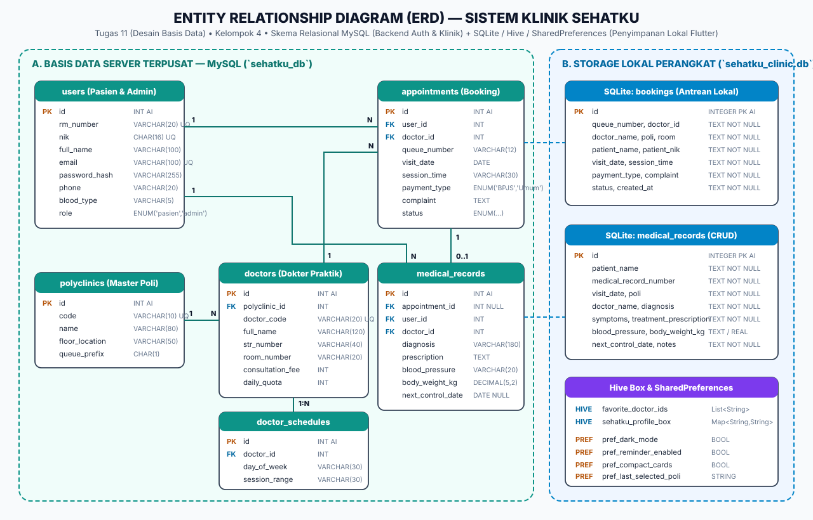

# SehatKu - Aplikasi Pendaftaran & Rekam Medis Klinik

**Kelompok 4 - Proyek UAS Project-Based Learning (PBL)**  
**Mata Kuliah:** Pengembangan Aplikasi Perangkat Bergerak (A) - Semester Ganjil 2026/2027  
**Program Studi:** Sistem Informasi, FMIPA Universitas Tanjungpura  
**Dosen Pengampu:** Syahru Rahmayuda, S.Kom., M.Kom.

---

## Anggota Kelompok 4

| No | Nama Anggota | Peran | Fokus Cakupan Tugas |
| :---: | :--- | :--- | :--- |
| 1 | **M. Arifqu Wa Liin (Arif)** | Lead Developer | Arsitektur, Routing & Auth Guard, MultiProvider, Demo Async vs Sync Event Loop, Backend Auth PHP + MySQL (bcrypt), Notifikasi Lokal & Galeri Medis, QR Antrean, Build APK & Web |
| 2 | **M. Fadjri Akbar (Fajri)** | UI/UX & Data Developer | Wireframe 3 Layar, Tema & Layout Responsif, List Dinamis 12 Dokter, 4+ Halaman UI, REST API JSON, SQLite/Hive/SharedPrefs, ERD DB |
| 3 | **Evan** | QA & Dokumentasi | Program Dasar Dart, Analisis Ekosistem & Bisnis, Widget `setState`, Unit/Widget Test & TDD, Laporan & Video Demo |

---

## Fitur Utama SehatKu

1. **Autentikasi Pasien PHP + MySQL & Proteksi Rute:** Registrasi, login, dan logout memakai tabel `users` (`sehatku_db`) dengan hash kata sandi bcrypt (`password_hash`/`password_verify`), token Bearer, persistensi sesi di `SharedPreferences`, proteksi rute lewat `AuthGate`, serta opsi Mode Demo Lokal saat server offline.
2. **Beranda & Tiket QR Antrean Online:** Pantau nomor antrean aktif per kode poli (`A` s.d. `F`), tampilkan **Tiket QR Antrean** siap pindai di meja registrasi klinik, ringkasan layanan, dan edukasi kesehatan dari REST API publik.
3. **Direktori 12 Dokter & Filter Poli Dinamis:** Pencarian *real-time* dan filter 6 poliklinik (*Poli Umum, Poli Gigi & Mulut, Poli Anak, Poli KIA & Kandungan, Poli Penyakit Dalam, Poli Mata & THT*) dalam tampilan `ListView` (mobile) maupun `GridView` (tablet/lebar), dilengkapi mode sumber data **REST API Publik (`DummyJSON`)**.
4. **Detail Dokter, Booking Online & Notifikasi Lokal:** Pengantaran objek model `Doctor` antar halaman via `AppRouter`, pemilihan tanggal & sesi jam praktik, penjamin *BPJS Kesehatan* / *Pasien Umum*, penerbitan nomor antrean otomatis ke SQLite, serta notifikasi lokal (`flutter_local_notifications`) dengan penanganan izin runtime.
5. **Rekam Medis Ringkas (SQLite CRUD) & Lampiran Galeri/Kamera:** Tambah, lihat, ubah, filter, dan hapus catatan riwayat diagnosis, tanda vital, resep obat, jadwal kontrol ulang, serta lampiran foto dokumen medis (`image_picker` + `permission_handler`) secara *offline-first*.
6. **Lab Asinkron & Event Loop:** Halaman demo perbandingan eksekusi sinkron (blocking) vs asinkron (`Microtask`, `Event Queue`, `Future.delayed`, dan `Future.wait` paralel) disertai uji skenario jaringan sukses, timeout, dan offline.
7. **Profil Medis, Dokter Favorit & Preferensi (Hive + SharedPreferences):** Penyimpanan identitas medis pasien & dokter favorit di **Hive**, pengaturan Mode Gelap, pengingat kontrol H-1, tampilan kartu ringkas di **SharedPreferences**, dan grafik rekap kunjungan per poli.

---

## Dokumentasi Desain, Arsitektur & Basis Data

- **Setup & Arsitektur Teknis (Arif):** [`docs/arsitektur_dan_setup_arif.md`](docs/arsitektur_dan_setup_arif.md)
- **Ringkasan Pengerjaan Lead Developer (Arif):** [`docs/dokumentasi_bagian_arif.md`](docs/dokumentasi_bagian_arif.md)
- **Panduan Backend PHP PDO + MySQL:** [`backend/README.md`](backend/README.md)
- **Wireframe 3 Layar Utama & Sistem Desain UI/UX:** [`docs/wireframe_dan_desain_ui.md`](docs/wireframe_dan_desain_ui.md)
- **Diagram ERD & Kamus Data (MySQL + SQLite/Hive/Prefs):** [`docs/erd_database_sehatku.md`](docs/erd_database_sehatku.md)
- **Skema SQL MySQL (Siap Import phpMyAdmin):** [`database/mysql_sehatku_schema.sql`](database/mysql_sehatku_schema.sql)
- **Skema SQL SQLite Lokal:** [`database/sqlite_local_schema.sql`](database/sqlite_local_schema.sql)
- **Ringkasan Pengerjaan Bagian UI/UX & Data (Fajri):** [`docs/dokumentasi_bagian_fajri.md`](docs/dokumentasi_bagian_fajri.md)

### Pratinjau Wireframe 3 Layar Utama


### Pratinjau Diagram ERD Sistem Klinik SehatKu


---

## Struktur Direktori Proyek

```text
sehatku/
├── assets/images/               # Aset gambar lokal banner klinik & avatar dokter
├── backend/                     # REST API autentikasi PHP PDO + MySQL (register, login, me, logout)
├── database/                    # Skema SQL MySQL (sehatku_db) & SQLite lokal
├── docs/                        # Dokumentasi wireframe SVG, ERD SVG, arsitektur & panduan tim
├── lib/
│   ├── data/                    # Dataset lokal 12 dokter klinik lintas 6 poli & seed data
│   ├── models/                  # Model class (AppUser, Doctor, BookingAppointment, MedicalRecord, HealthArticle)
│   ├── providers/               # State global (AuthProvider, ClinicDataProvider)
│   ├── routing/                 # AppRouter, named routes & AuthGate proteksi halaman
│   ├── screens/                 # Login, Register, Home, DoctorSchedule, BookingDetail, MedicalRecord, Profile, AsyncLab, QrTicket
│   ├── services/                # ApiService, AuthService, AsyncDemoService, DatabaseHelper, LocalStorageService, NotificationService, MediaService
│   ├── theme/                   # SehatKuTheme (Light/Dark Material 3) & helper responsif
│   ├── widgets/                 # DoctorCard & MedicalDocumentPreview
│   └── main.dart                # Entry point MaterialApp, MultiProvider & AppRouter
├── tool/                        # Skrip CLI perbandingan sinkron vs asinkron Dart Event Loop
└── test/                        # Pengujian unit & widget (API, Auth, Async, SQLite, Hive/Prefs, QR, responsif)
```

---

## Cara Instalasi & Menjalankan Aplikasi

1. Pastikan **Flutter SDK** (`flutter --version`) dan **PHP + MySQL** (Laragon/XAMPP) telah terpasang.
2. Import skema database MySQL ke server lokal:
   ```bash
   mysql -u root < database/mysql_sehatku_schema.sql
   ```
3. Jalankan backend autentikasi PHP lokal:
   ```bash
   php -S 0.0.0.0:8080 -t backend backend/index.php
   ```
4. Unduh dependensi proyek Flutter:
   ```bash
   flutter pub get
   ```
5. Jalankan aplikasi di emulator Android, perangkat fisik, atau browser Chrome:
   ```bash
   flutter run -d chrome
   # atau pada perangkat/emulator Android:
   flutter run
   ```
6. Jalankan demo konsol perbandingan sinkron vs asinkron (Tugas 8):
   ```bash
   dart run tool/sync_vs_async_demo.dart
   ```
7. Jalankan analisis kode & seluruh pengujian otomatis:
   ```bash
   flutter analyze
   flutter test
   ```
8. Build APK Release & Flutter Web:
   ```bash
   flutter build apk --release
   flutter build web --release
   ```
