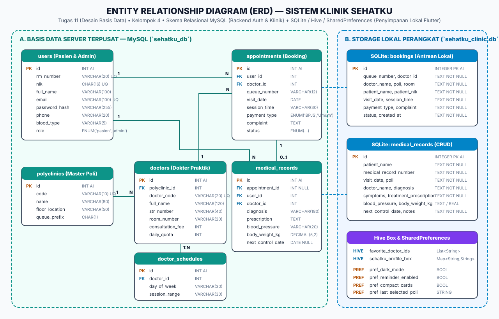
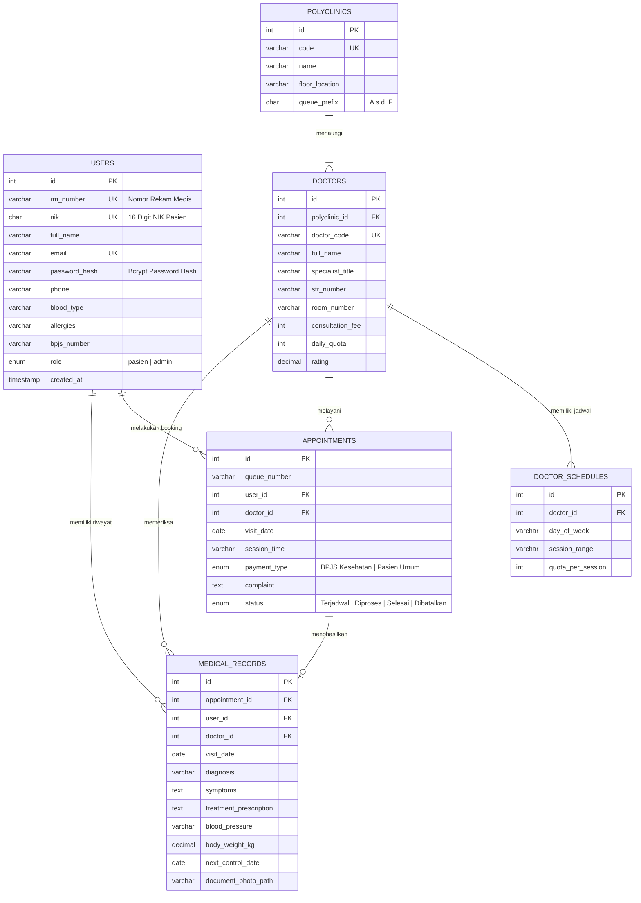

# Desain Basis Data & Diagram ERD — Sistem Klinik SehatKu

**Kelompok 4 — SehatKu**  
**Mata Kuliah:** Pengembangan Aplikasi Perangkat Bergerak (A) — Semester Ganjil 2026/2027  
**Penanggung Jawab Desain Basis Data:** M. Fadjri Akbar (Jalur UI/UX & Data — Langkah 7)  
**Indikator Capaian:** Sub-CPMK0539 (Tugas 10 — Penyimpanan Data Lokal SQLite/Hive/Prefs) & Sub-CPMK05310 (Tugas 11 — Desain Basis Data & ERD MySQL)

---

## 1. Arsitektur Penyimpanan Hibrida (Server MySQL + Lokal Offline-First)

Aplikasi **SehatKu** dirancang dengan arsitektur penyimpanan dua lapis agar pasien tetap dapat membuka jadwal kontrol dan rekam medis meskipun koneksi internet klinik sedang terganggu:

1. **Basis Data Terpusat MySQL (`sehatku_db`):** Digunakan oleh layanan backend autentikasi (Register/Login dengan *hash password* `bcrypt`), manajemen master poli, jadwal praktik dokter, dan rekap kunjungan klinik lintas poli. Skrip SQL siap impor tersedia pada [`database/mysql_sehatku_schema.sql`](../database/mysql_sehatku_schema.sql).
2. **Basis Data Lokal Perangkat (`SQLite` + `Hive` + `SharedPreferences`):**
   - **SQLite (`sehatku_clinic.db`):** Menyimpan operasi **CRUD Rekam Medis Ringkas** (`medical_records`) dan **Riwayat Booking Antrean** (`bookings`). Skrip skema tersedia pada [`database/sqlite_local_schema.sql`](../database/sqlite_local_schema.sql) dan diimplementasikan di [`lib/services/database_helper.dart`](../lib/services/database_helper.dart).
   - **Hive (`sehatku_favorites_box` & `sehatku_profile_box`):** Menyimpan daftar **Dokter Favorit** dan **Profil Identitas Medis Pasien** secara persisten.
   - **SharedPreferences:** Menyimpan preferensi pengguna (*Mode Gelap*, *Pengingat Kontrol H-1*, *Tampilan Kartu Ringkas*, serta *Filter Poli Terakhir*).

---

## 2. Diagram Visual ERD (MySQL & Penyimpanan Lokal)

---

## 3. Diagram Relasi Entitas (Mermaid `erDiagram`)

---

## 4. Kamus Data Penyimpanan Lokal Flutter (Tugas 10)

### A. Tabel SQLite `medical_records`
| Nama Kolom | Tipe Data | Keterangan |
| :--- | :--- | :--- |
| `id` | `INTEGER PRIMARY KEY AUTOINCREMENT` | Kunci utama otomatis setiap catatan rekam medis. |
| `patient_name` | `TEXT NOT NULL` | Nama lengkap pasien. |
| `medical_record_number` | `TEXT NOT NULL` | Nomor Rekam Medis klinik (mis. `RM-2026-0104`). |
| `visit_date` | `TEXT NOT NULL` | Tanggal pemeriksaan kunjungan klinik. |
| `poli` | `TEXT NOT NULL` | Nama poliklinik tujuan (mendukung agregasi analitik kunjungan per poli). |
| `doctor_name` | `TEXT NOT NULL` | Nama dokter pemeriksa beserta gelar. |
| `diagnosis` | `TEXT NOT NULL` | Diagnosis medis hasil pemeriksaan dokter. |
| `symptoms` | `TEXT NOT NULL` | Keluhan/gejala awal pasien. |
| `treatment_prescription` | `TEXT NOT NULL` | Tindakan medis & rincian resep obat. |
| `blood_pressure` | `TEXT NOT NULL` | Tekanan darah pasien (mis. `120/80 mmHg`). |
| `body_weight_kg` | `REAL NOT NULL` | Berat badan pasien dalam kilogram. |
| `next_control_date` | `TEXT NOT NULL` | Jadwal kontrol ulang berikutnya. |
| `notes` | `TEXT NOT NULL` | Catatan edukasi tambahan dokter. |

### B. Tabel SQLite `bookings`
| Nama Kolom | Tipe Data | Keterangan |
| :--- | :--- | :--- |
| `id` | `INTEGER PRIMARY KEY AUTOINCREMENT` | Kunci utama antrean lokal. |
| `queue_number` | `TEXT NOT NULL` | Nomor tiket antrean per kode poli (`A-012`, `B-013`, dst.). |
| `doctor_id`, `doctor_name` | `TEXT NOT NULL` | Identitas dokter tujuan booking. |
| `poli`, `room` | `TEXT NOT NULL` | Nama poli dan ruangan praktik. |
| `patient_name`, `patient_nik` | `TEXT NOT NULL` | Identitas pendaftar kunjungan. |
| `visit_date`, `session_time` | `TEXT NOT NULL` | Tanggal dan jam sesi praktik yang dipilih. |
| `payment_type`, `complaint` | `TEXT NOT NULL` | Jenis penjamin (`BPJS Kesehatan`/`Pasien Umum`) & keluhan. |
| `status`, `created_at` | `TEXT NOT NULL` | Status jadwal (`Terjadwal`/`Selesai`/`Dibatalkan`) & waktu buat. |

---

## 5. Cara Import Skema MySQL di phpMyAdmin / Laragon / XAMPP

1. Buka **phpMyAdmin** (`http://localhost/phpmyadmin`) atau terminal MySQL.
2. Pilih menu **Import** → pilih file [`database/mysql_sehatku_schema.sql`](../database/mysql_sehatku_schema.sql) → klik **Go / Kirim**.
3. Database `sehatku_db` beserta 6 tabel berelasi (`polyclinics`, `users`, `doctors`, `doctor_schedules`, `appointments`, `medical_records`) dan data awal (*seed*) akan otomatis terbentuk.
