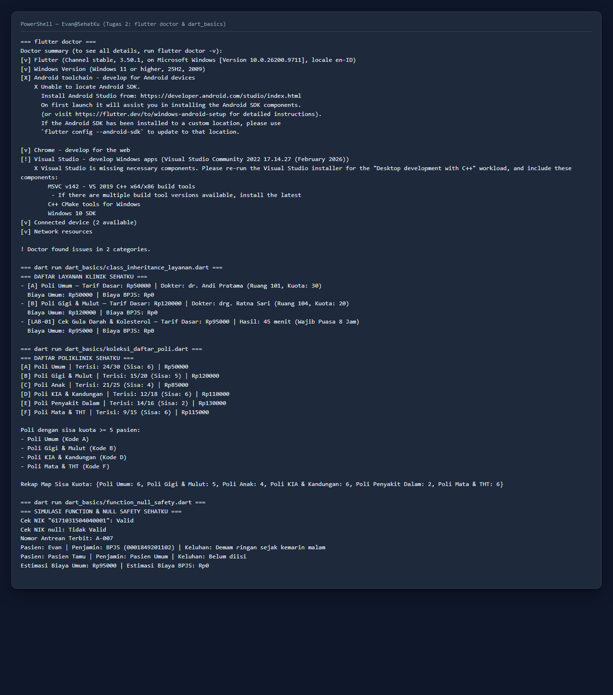
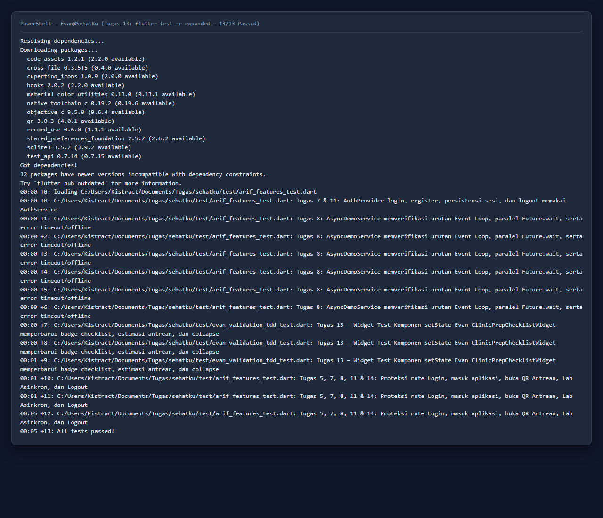
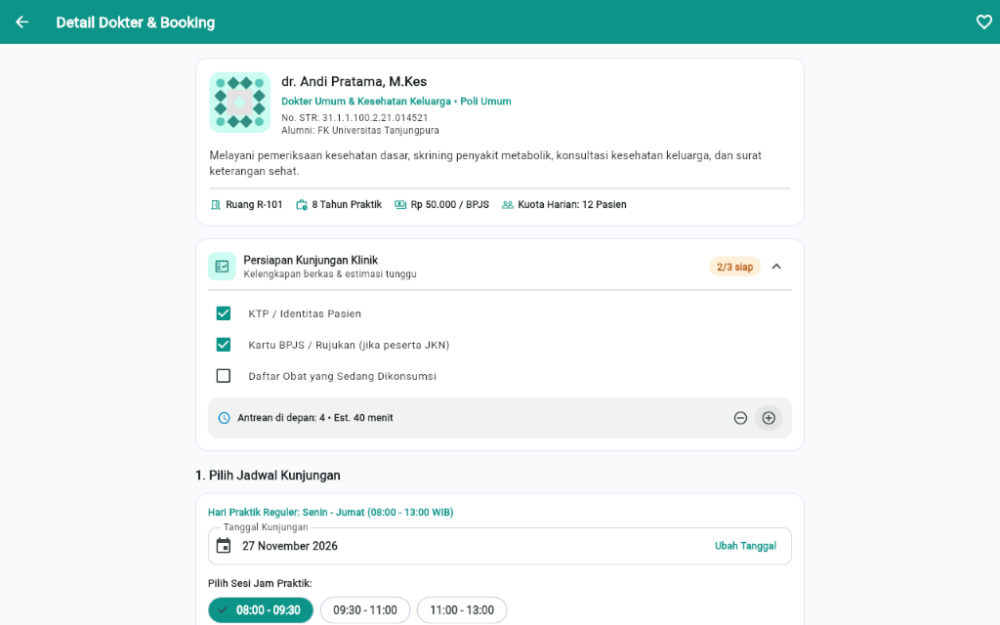
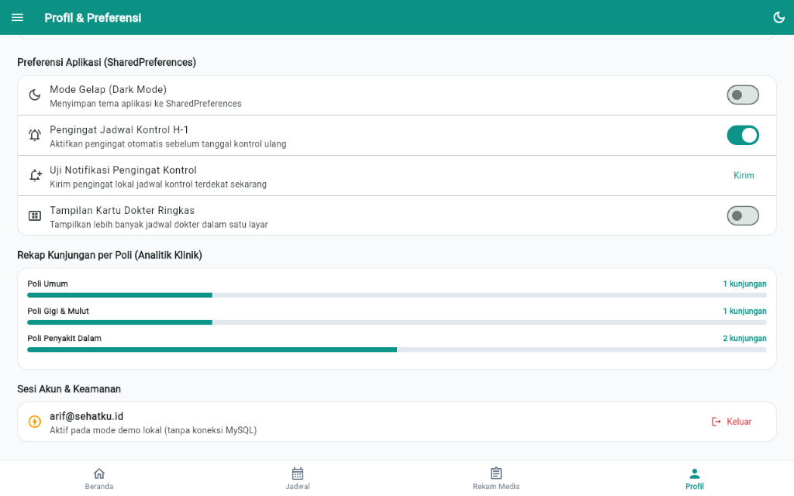
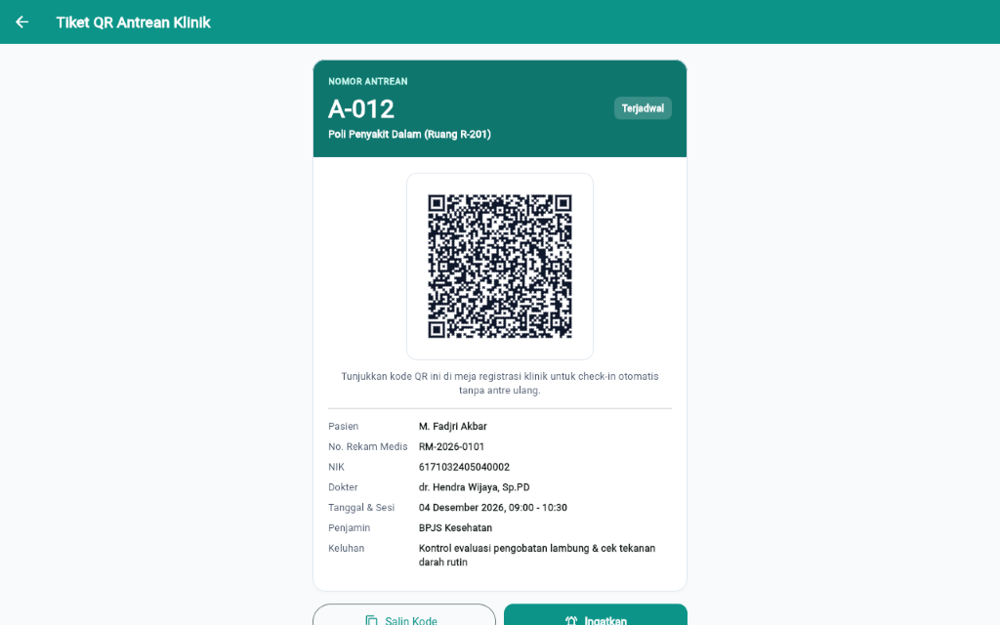

# LAPORAN AKHIR PROYEK UAS PBL
## Aplikasi Pendaftaran Antrean & Rekam Medis Klinik **SehatKu**

**Mata Kuliah:** Pengembangan Aplikasi Perangkat Bergerak (A)  
**Semester:** Ganjil 2026/2027  
**Program Studi:** Sistem Informasi, FMIPA Universitas Tanjungpura  
**Dosen Pengampu:** Syahru Rahmayuda, S.Kom., M.Kom.  

**Kelompok 4 — SehatKu:**
1. **M. Arifqu Wa Liin (Arif)** — Lead Developer
2. **M. Fadjri Akbar (Fajri)** — UI/UX & Data Developer
3. **Evan** — QA, Dokumentasi & Fitur Dasar

**Tautan Penting:**
- Repository GitHub: `https://github.com/arifquuu/sehatku`
- Rilis APK & Web (`v1.0.0`): `https://github.com/arifquuu/sehatku/releases/tag/v1.0.0`

---

## BAB 1. PENDAHULUAN & ANALISIS KEBUTUHAN

### 1.1 Latar Belakang Masalah
Di banyak klinik pratama, pasien masih harus datang lebih awal untuk mengambil nomor antrean kertas, jadwal praktik dokter sering berubah tanpa informasi real-time, serta catatan resep atau riwayat kontrol mudah tercecer.

### 1.2 Solusi yang Ditawarkan (SehatKu)
**SehatKu** adalah aplikasi mobile (Android) dan web berbasis Flutter dengan tiga kemampuan inti:
1. **Direktori & Booking Antrean Poliklinik:** Menampilkan 12 dokter lintas 6 poliklinik (Poli Umum, Gigi & Mulut, Anak, KIA & Kandungan, Penyakit Dalam, Mata & THT) lengkap dengan kuota, ruangan, estimasi tarif/BPJS, dan pencarian/filter poli dinamis.
2. **Tiket QR Antrean & Notifikasi Pengingat:** Menerbitkan nomor antrean per kode poli (`A`–`F`), tiket QR siap pindai, serta pengingat jadwal kontrol lokal.
3. **Rekam Medis Offline-First:** Menyimpan riwayat diagnosis, tanda vital, resep, dan lampiran foto dokumen medis secara lokal di perangkat (SQLite & Hive).

### 1.3 Analisis Pemilihan Flutter (Tugas 1)
Ringkasan lengkap tersedia pada [`docs/analisis_flutter_sehatku.md`](analisis_flutter_sehatku.md). Flutter dipilih karena menawarkan *single codebase* untuk Android & Web, performa rendering tinggi, konsistensi Material 3 (Light & Dark Mode), serta ekosistem paket lengkap (`provider`, `sqflite`, `hive_flutter`, `flutter_local_notifications`, `image_picker`, `qr_flutter`).

---

## BAB 2. PERANCANGAN UI/UX & BASIS DATA

### 2.1 Wireframe 3 Layar Utama (Tugas 1)
Wireframe dirancang untuk layar Beranda/Jadwal Dokter, Detail & Form Booking, serta Riwayat Rekam Medis.
- Dokumen detail: [`docs/wireframe_dan_desain_ui.md`](wireframe_dan_desain_ui.md)
- Aset visual SVG: [`docs/wireframes/wireframe_3_layar_utama_sehatku.svg`](wireframes/wireframe_3_layar_utama_sehatku.svg)

### 2.2 Desain Tema & Layout Responsif (Tugas 3)
`SehatKuTheme` (`lib/theme/sehatku_theme.dart`) menerapkan palet medis Teal (`#0D9488`) dengan dukungan **Light Mode** dan **Dark Mode**. Tata letak diuji di 2 ukuran layar:
- **Mobile (< 650 px):** Menggunakan `ListView` satu kolom dengan `BottomNavigationBar`.
- **Tablet/Lebar (>= 650 px):** Beralih otomatis ke `GridView` 2–3 kolom.

### 2.3 ERD & Skema Basis Data (Tugas 11)
SehatKu menggunakan skema relasional MySQL (`sehatku_db`) dengan 6 tabel (`polyclinics`, `users`, `doctors`, `doctor_schedules`, `appointments`, `medical_records`) serta SQLite lokal (`sehatku_clinic.db`) untuk penyimpanan *offline-first*.
- Dokumen detail: [`docs/erd_database_sehatku.md`](erd_database_sehatku.md)
- Aset visual ERD: [`docs/erd/erd_sehatku_database.svg`](erd/erd_sehatku_database.svg)
- Skema SQL: [`database/mysql_sehatku_schema.sql`](../database/mysql_sehatku_schema.sql) dan [`database/sqlite_local_schema.sql`](../database/sqlite_local_schema.sql)

---

## BAB 3. IMPLEMENTASI TEKNIS & FITUR APLIKASI

### 3.1 Pemrograman Dart Dasar (Tugas 2)
Tiga program Dart dasar bertema SehatKu disimpan di folder [`dart_basics/`](../dart_basics/):
1. `class_inheritance_layanan.dart` — Class & inheritance (`LayananKlinik` → `LayananPoli` & `LayananLaboratorium`).
2. `koleksi_daftar_poli.dart` — Koleksi `List` & `Map` untuk 6 poliklinik dan sisa kuota.
3. `function_null_safety.dart` — Function & null safety (`?`, `??`, `?.`) untuk validasi NIK dan estimasi biaya.

### 3.2 Navigasi, State Management & Widget `setState` (Tugas 5, 6, 7)
- **Routing & Auth Guard:** `AppRouter` (`lib/routing/app_router.dart`) mengatur named routes (`/login`, `/register`, `/`, `/jadwal`, `/booking`, `/rekam-medis`, `/profil`, `/async-lab`, `/qr-ticket`) dengan `AuthGate`.
- **Global State:** `MultiProvider` (`AuthProvider` & `ClinicDataProvider`) menyinkronkan sesi pasien, booking, rekam medis, favorit, dan tema lintas halaman.
- **Ephemeral State (`setState`):** `ClinicPrepChecklistWidget` (`lib/widgets/clinic_prep_checklist_widget.dart`) pada halaman Detail Dokter & Booking mengelola checklist persiapan kunjungan dan simulasi estimasi waktu tunggu secara lokal.

### 3.3 Pemrograman Asinkron, REST API, Storage Lokal & Fitur Perangkat (Tugas 8, 9, 10, 12, 14)
- **Asinkron & Event Loop (Tugas 8):** `AsyncDemoService` & `AsyncComparisonScreen` + skrip CLI `tool/sync_vs_async_demo.dart`.
- **REST API Publik (Tugas 9):** `ApiService` mengambil data `/users` dan `/posts` dari `DummyJSON`.
- **Storage Lokal (Tugas 10):** SQLite (CRUD rekam medis & booking), Hive (dokter favorit & profil medis), SharedPreferences (sesi, Mode Gelap, pengingat kontrol, filter poli).
- **Autentikasi MySQL (Tugas 11):** Backend PHP PDO (`backend/index.php`) dengan hash `bcrypt` + tombol Mode Demo Lokal.
- **Notifikasi & Galeri (Tugas 12):** `NotificationService` (`flutter_local_notifications`) dan `MediaService` (`image_picker` + `permission_handler`).
- **Fitur Inovatif & Build (Tugas 14):** `QrQueueTicketScreen` (`qr_flutter`) dengan zona tenang putih di Mode Gelap, serta build APK Release & Flutter Web (`v1.0.0`).

---

## BAB 4. PENGUJIAN, TDD, DEBUGGING & ANALISIS BISNIS

### 4.1 Unit Test, Widget Test & TDD (Tugas 13)
Detail lengkap tersedia pada [`docs/tdd_dan_testing_evan.md`](tdd_dan_testing_evan.md).
- Terdapat 3 berkas test di `test/` (`widget_test.dart`, `arif_features_test.dart`, dan `evan_validation_tdd_test.dart`) dengan total 13 skenario uji.
- Siklus TDD (**Red → Green → Refactor**) diterapkan pada `PatientValidator.formatQueueNumber`.

### 4.2 Bug Log Integrasi & Perbaikan
1. **Overflow Layar Mobile 390px & Timer Timeout Menggantung** pada `LoginScreen`, `ProfileScreen`, dan `AsyncDemoService` (diperbaiki di commit `5f8250e`).
2. **Konflik AGP 9.1.0 & `compileSdk 36`** saat build APK Release karena plugin notifikasi/permission membutuhkan `compileSdk 37` (diperbaiki di commit `7a63b96`).

### 4.3 Analisis Bisnis & Kewirausahaan Digital (Tugas 14)
Detail lengkap tersedia pada [`docs/analisis_bisnis_sehatku.md`](analisis_bisnis_sehatku.md). Rekap kunjungan per poli (`visitCountByPoli`) membantu manajemen klinik menjadwalkan dokter dan kuota sesuai beban poli, sementara Tiket QR Antrean menekan biaya cetak kertas dan mempercepat check-in pasien.

---

## BAB 5. KESIMPULAN & SARAN

### 5.1 Kesimpulan
Aplikasi **SehatKu** berhasil dibangun dan diintegrasikan secara penuh oleh Kelompok 4 (Arif, Fajri, Evan) dengan fitur pendaftaran antrean daring, tiket QR, rekam medis *offline-first*, autentikasi MySQL, notifikasi lokal, lampiran foto dokumen medis, serta pengujian otomatis yang terstruktur.

### 5.2 Saran Pengembangan
1. Menambahkan sinkronisasi dua arah antara SQLite lokal dan server MySQL.
2. Menambahkan fitur pemindai QR di sisi petugas resepsionis klinik.

---

## LAMPIRAN BUKTI SCREENSHOT, LOG & VIDEO
- [x] Log & screenshot `flutter doctor` + output konsol 3 program `dart_basics/`: [`docs/logs/flutter_doctor_dan_dart_basics.txt`](logs/flutter_doctor_dan_dart_basics.txt) & [`docs/screenshots/01_flutter_doctor_dan_dart_basics.png`](screenshots/01_flutter_doctor_dan_dart_basics.png)
- [x] Log & screenshot hasil `flutter test` (`13/13 passed`): [`docs/logs/flutter_test_results.txt`](logs/flutter_test_results.txt) & [`docs/screenshots/02_hasil_flutter_test.png`](screenshots/02_hasil_flutter_test.png)
- [x] Screenshot aplikasi berjalan (`Login`, `Beranda`, `Detail Booking & Widget setState`, `Rekam Medis`, `Profil & Grafik Poli`, `QR Antrean`): [`docs/screenshots/`](screenshots/)
- [ ] Video bukti penyimpanan lokal (Tugas 10 — dibantu Fadjri/rekam ulang dari APK)
- [ ] Video demo aplikasi 3–5 menit (Tugas 14 — ikuti naskah di [`docs/panduan_video_demo_sehatku.md`](panduan_video_demo_sehatku.md))

### Cuplikan Layar Hasil Eksekusi & Aplikasi

