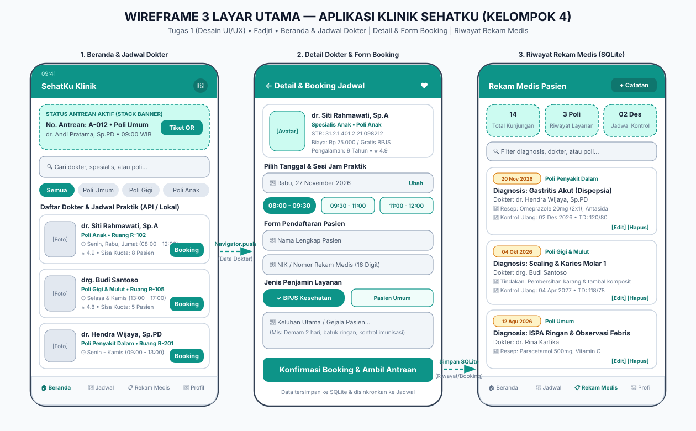
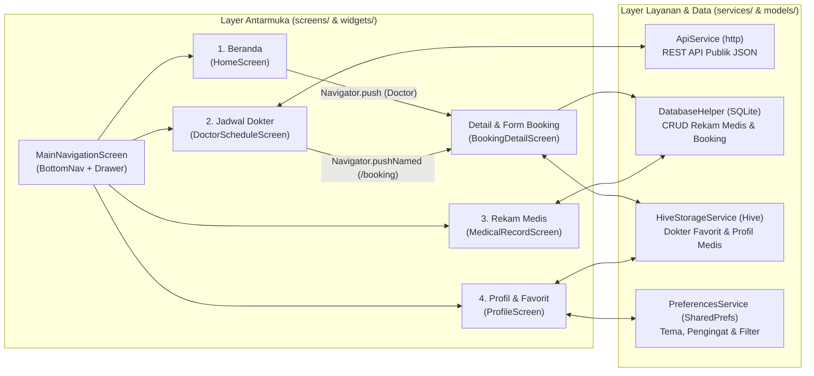

# Dokumentasi Wireframe & Desain UI/UX — Aplikasi Klinik SehatKu

**Kelompok 4 — SehatKu**  
**Mata Kuliah:** Pengembangan Aplikasi Perangkat Bergerak (A) — Semester Ganjil 2026/2027  
**Penanggung Jawab Desain UI/UX & Data:** M. Fadjri Akbar (Jalur UI/UX & Data — Langkah 1)  
**Indikator Capaian:** CPMK012 • Sub-CPMK0121 (Tugas 1 — Desain Wireframe & Arsitektur UI) & Sub-CPMK0532 (Tugas 3 — Tema & Layout Responsif)

---

## 1. Latar Belakang Desain Antarmuka SehatKu

Pasien klinik sering mengalami kendala antrean pagi yang panjang, jadwal praktik dokter yang tidak transparan, serta hilangnya catatan riwayat kunjungan/rekam medis ringkas. Oleh karena itu, antarmuka **SehatKu** dirancang dengan tiga prinsip utama:

1. **Transparansi Jadwal & Kuota Real-Time:** Pasien langsung melihat poli, jam praktik, ruangan, serta sisa kuota dokter sejak membuka layar pertama.
2. **Pendaftaran Cepat (3 Ketukan):** Dari Beranda/Jadwal → Pilih Dokter → Konfirmasi Sesi & Keluhan → Nomor Antrean langsung diterbitkan.
3. **Akses Rekam Medis Offline-First:** Catatan diagnosis, tindakan, tekanan darah, resep obat, dan jadwal kontrol ulang tersimpan lokal menggunakan **SQLite**, sementara daftar dokter favorit & preferensi pasien disimpan di **Hive** dan **SharedPreferences**.

---

## 2. Identitas Visual & Sistem Desain (Design System)

| Elemen Desain | Spesifikasi Nilai | Alasan Pemilihan |
| :--- | :--- | :--- |
| **Warna Primer (Medical Teal)** | `#0D9488` (Teal 600) & `#0F766E` (Teal 700) | Memberikan kesan higienis, menenangkan, profesional, dan identik dengan layanan kesehatan modern. |
| **Warna Sekunder / Aksen** | `#0284C7` (Clinical Sky Blue) & `#F59E0B` (Amber Status) | Membedakan informasi jadwal aktif, nomor antrean, dan pengingat jadwal kontrol. |
| **Warna Permukaan (Surface)** | `#F8FAFC` (Light Slate) / `#0F172A` (Mode Gelap) | Kontras keterbacaan tinggi (WCAG AA) untuk teks rekam medis dan lansia. |
| **Tipografi** | `Segoe UI` / `Roboto` (Material 3 Typography Scale) | Keterbacaan optimal untuk jadwal angka, nomor STR, dosis obat, dan diagnosis medis. |
| **Sudut Komponen (Radius)** | `12px–16px` pada `Card` & `TextField` | Tampilan ramah (friendly clinical UI) dan konsisten di Android maupun Web. |

---

## 3. Pratinjau Wireframe 3 Layar Utama SehatKu

### Layar 1 — Beranda & Jadwal Dokter (`HomeScreen` & `DoctorScheduleScreen`)
- **AppBar:** Menampilkan identitas klinik *SehatKu*, indikator sinkronisasi REST API, dan tombol pintas pengingat kontrol.
- **Hero Banner Antrean (`Stack` + `Container`):** Menampilkan tiket nomor antrean aktif pasien (mis. `A-012`), nama dokter, poli, dan jam kunjungan berikutnya.
- **Kolom Pencarian (`TextField`) & Filter Poli (`ChoiceChip`):** Memungkinkan pencarian nama dokter/spesialisasi secara *real-time* dan penyaringan per poli (*Poli Umum, Poli Gigi & Mulut, Poli Anak, Poli KIA/Kandungan, Poli Penyakit Dalam, Poli Mata & THT*).
- **Daftar Dokter Dinamis (`ListView.builder` / `GridView.builder`):** Menampilkan foto/avatar dokter (`Image` dengan fallback aman), nama & gelar, ruangan, hari/jam praktik, tarif/BPJS, rating, sisa kuota, dan tombol **Booking**.

### Layar 2 — Detail Dokter & Form Booking Online (`BookingDetailScreen`)
- **Navigasi Pengantaran Data:** Dibuka melalui `Navigator.pushNamed` / `Navigator.push` dengan mengirimkan objek model `Doctor` dari halaman daftar.
- **Kartu Informasi Dokter:** Menampilkan profil lengkap dokter, Nomor STR, pengalaman praktik, jadwal tersedia, serta tombol simpan ke **Dokter Favorit** (tersimpan di *Hive*).
- **Pemilih Tanggal & Slot Jam Praktik:** Pilihan tanggal kunjungan serta chip sesi jam praktik (*Pagi / Siang / Sore*).
- **Form Pendaftaran Pasien:** Input nama pasien, NIK (16 digit), jenis penjamin (*BPJS Kesehatan* atau *Pasien Umum*), dan keluhan utama. Saat dikonfirmasi, data booking disimpan ke **SQLite** dan menghasilkan nomor antrean otomatis.

### Layar 3 — Riwayat Rekam Medis Ringkas (`MedicalRecordScreen`)
- **Ringkasan Kunjungan:** Kartu metrik jumlah kunjungan pasien, jumlah poli yang pernah dikunjungi, dan tanggal kontrol terdekat.
- **Daftar CRUD Rekam Medis (SQLite):** Menampilkan riwayat pemeriksaan pasien berisi tanggal periksa, poli, dokter pemeriksa, diagnosis, tekanan darah/tanda vital, tindakan/resep obat, dan jadwal kontrol ulang.
- **Fitur CRUD Lengkap:** Pasien/petugas dapat **Menambah** catatan medis baru (`+ Catatan`), **Melihat Detail**, **Mengubah/Edit** catatan, **Menghapus** data, serta memfilter riwayat per poli.

### Layar Pendukung (Layar ke-4) — Profil Pasien, Dokter Favorit & Preferensi (`ProfileScreen`)
- Melengkapi syarat minimal 4 halaman + `BottomNavigationBar` & `Drawer` pada **Tugas 5**:
  - Profil identitas medis pasien (Nomor RM, NIK, Golongan Darah, Riwayat Alergi Obat — disimpan di **Hive**).
  - Daftar **Dokter Favorit** yang ditandai pasien.
  - Pengaturan preferensi aplikasi (**SharedPreferences**): Mode Gelap (*Dark Mode*), Pengingat Jadwal Kontrol H-1, dan Tampilan Daftar Kompak.

---

## 4. Alur Navigasi & Arsitektur Komponen UI–Data

---

## 5. Strategi Responsivitas 2 Ukuran Layar (Tugas 3)

| Kategori Layar | Breakpoint Lebar | Adaptasi Layout SehatKu |
| :--- | :--- | :--- |
| **Mobile (Smartphone)** | `< 650 px` (mis. `390 × 844`) | Menggunakan `ListView.builder` 1 kolom vertikal, kartu banner penuh, dan `BottomNavigationBar` di bagian bawah layar. |
| **Tablet / Layar Lebar (Web/Desktop)** | `>= 650 px` (mis. `1024 × 768`) | Menggunakan `LayoutBuilder` yang otomatis mengubah daftar dokter & rekam medis menjadi `GridView.builder` 2 kolom proporsional, memperluas header klinik dalam `Row` dua sisi, serta menampilkan `Drawer` navigasi cepat. |
